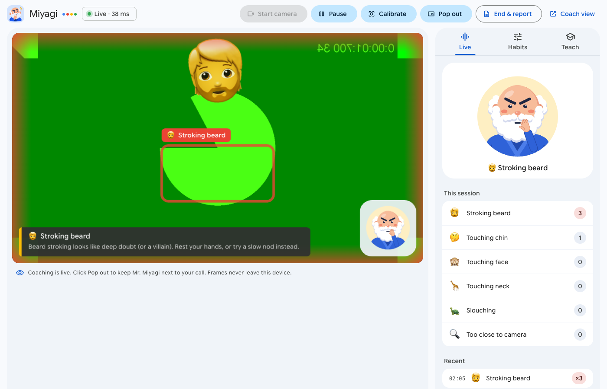
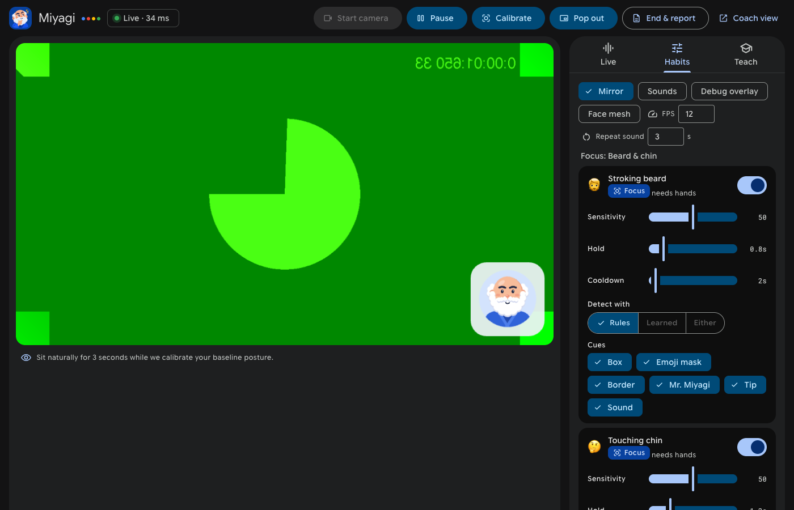
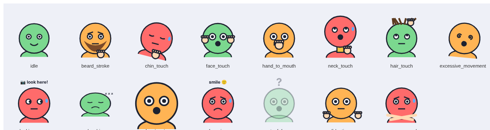

# Meeting Coach

A local, AI-powered web app that watches your webcam **during video meetings** and gently
alerts you, in real time, when you slip into unconscious habits.

**Current focus: beard stroking and chin touching** (on by default). Twelve more habits
(touching face or neck, hair, hand at mouth, rocking, looking away, slouching, frowning...)
are built in and switched off; turn them on under *Habits → More habits* when you want them.

When a habit is detected you get a cue of your choice: a **red rectangle** around the spot,
an **emoji mask** over your face, a **glowing border**, a cartoon **avatar ("Coachy") that acts
out what you're doing**, a **toast** with a tip, or a soft **sound**. Repeat a habit and the
cues get louder. At the end you get a short **coaching report**.

The UI follows **Material Design 3** (Google colors, Google Sans Flex, Material Symbols), in light and dark.



<details><summary>Dark theme and the Habits settings</summary>



</details>



> **Privacy:** video is analysed on your machine and never stored or uploaded. The optional
> AI report only receives aggregate counts (e.g. "chin touch × 4"), never images. Fonts and
> icons are bundled, so the UI makes no third-party requests.

## Quick start

Requires [uv](https://docs.astral.sh/uv/) and a webcam.

```bash
git clone https://github.com/SherifEldeeb/meeting_coach && cd meeting_coach
uv sync
uv run meeting-coach          # first run downloads ~17 MB of vision models, then opens http://localhost:8000
```

1. Click **Start camera** and sit naturally for 3 seconds while it calibrates.
2. Click **Pop out** for a small always-on-top coach window to keep next to Zoom, Meet or Teams.
3. When you're done, click **End & report**.

### Port and host

```bash
uv run meeting-coach --port 8080                 # or: MEETING_COACH_PORT=8080 uv run meeting-coach
uv run meeting-coach --host 0.0.0.0 --port 8080  # listen on all interfaces (other machines need HTTPS for the camera)
```

> Habit settings are saved per browser **origin**, which includes the port. If you change the port,
> set up your habits again (or keep using the same port).

### Coach view ("production" mode): camera and cues only

For meetings you probably don't want toolbars and settings on screen. The **coach view** shows
only the camera and the cues (box, mask, border, Coachy, tips). It starts the camera automatically
and uses the habit settings you saved in the full UI.

```bash
uv run meeting-coach --coach --port 8080         # opens http://localhost:8080/coach
```

You can also open `http://localhost:<port>/coach` any time, or click **Coach view** in the full UI.
There are no on-screen controls, only keyboard shortcuts:

| Key | Action |
|---|---|
| `P` | pop out (floating, always-on-top window) |
| `C` | calibrate (sit naturally for 3 s) |
| `Space` | pause / resume |
| `F` or double-click | full screen |
| `M` | mirror on/off |
| `H` or `?` | show these shortcuts |

Tune habits in the full UI (`http://localhost:<port>/`), then use the coach view during calls.

CLI options: `--port`, `--host`, `--coach`, `--no-browser` (`uv run meeting-coach --help`).

## Habits

| Habit | Default | What triggers it |
|---|---|---|
| 🧔 **Stroking beard** | **on (focus)** | hand *moving* on the beard/chin |
| 🤔 **Touching chin** | **on (focus)** | hand resting on the chin/jaw/beard, or propping your head |
| 🙈 Touching face | off | fingertips on eyes, nose or cheeks |
| 🤐 Hand at mouth | off | fingertips on the lips |
| 🦒 Touching neck | off | fingertips below the beard |
| 💇 Playing with hair | off | fingertips above the forehead |
| 🌀 Moving / rocking a lot | off | sustained head movement |
| 👀 Looking away from camera | off | head turned or eyes off the camera vs. your baseline |
| 🐢 Slouching | off | shoulders/neck lower than your baseline |
| 🔍 Too close to camera | off | face much bigger than your baseline |
| 😠 Frowning | off | furrowed brows |
| 🫥 Out of frame | off | no face for a few seconds |
| 🫨 Restless hands | off | lots of hand motion |
| 🙅 Arms crossed | off | arms crossed over the body |

Each habit has its own **sensitivity**, **hold time** (how long before it alerts), **cooldown**,
**detection mode** and **cues**, set in the *Habits* tab and remembered by your browser.
The *Debug overlay* shows the zones and hand points, which helps with tuning.

## Teach it your habits (personal model)

People stroke beards differently. In the **Teach** tab:

1. Record **Neutral** (sit and talk normally) for about 10 s.
2. Record **Stroking beard** and **Touching chin** for about 10 s each, varying the gesture a little.
3. Click **Train personal model** (it takes about a second, on your CPU).
4. In *Habits*, set the habit's *Detect with* to `either` (rules OR your model) or `learned`.

Only landmark coordinates are saved (never images), in `~/.local/share/meeting_coach/`.
**Clear all samples** deletes them.

## AI coaching report (any vendor)

The report uses an LLM if one is configured, otherwise a built-in offline summary.
Choose a backend with `MEETING_COACH_LLM`:

| Backend | `MEETING_COACH_LLM` | Setup |
|---|---|---|
| **Gemini, API key** (default) | `gemini` | `export GEMINI_API_KEY=...` (or `GOOGLE_API_KEY`) |
| **Gemini on Vertex AI (ADC)** | `gemini` or `vertex` | `gcloud auth application-default login` and `export GOOGLE_GENAI_USE_VERTEXAI=true GOOGLE_CLOUD_PROJECT=my-project` (optional `GOOGLE_CLOUD_LOCATION`, default `global`) |
| OpenAI or any OpenAI-compatible server (Ollama, LM Studio, vLLM, Groq...) | `openai` | `uv sync --extra openai`; `OPENAI_API_KEY`, optionally `OPENAI_BASE_URL` + `MEETING_COACH_LLM_MODEL` |
| Anthropic Claude | `anthropic` | `uv sync --extra anthropic`; `ANTHROPIC_API_KEY` |
| Offline only | `none` | – |

Example with a local model through Ollama:

```bash
uv sync --extra openai
MEETING_COACH_LLM=openai OPENAI_BASE_URL=http://localhost:11434/v1 MEETING_COACH_LLM_MODEL=llama3.2 uv run meeting-coach
```

If the chosen backend isn't configured or fails, you get the offline report with a note saying why.

## Configuration

| Variable | Purpose | Default |
|---|---|---|
| `MEETING_COACH_PORT` | port (same as `--port`) | `8000` |
| `MEETING_COACH_HOST` | bind address (same as `--host`) | `127.0.0.1` |
| `MEETING_COACH_COACH_VIEW` | `1` opens the coach view on start (same as `--coach`) | off |
| `MEETING_COACH_LLM` | report backend: `gemini`, `vertex`, `openai`, `anthropic`, `none` | `gemini` |
| `MEETING_COACH_LLM_MODEL` | override the model name | per backend |
| `GEMINI_API_KEY` / `GOOGLE_API_KEY` | Gemini API key | – |
| `GOOGLE_GENAI_USE_VERTEXAI`, `GOOGLE_CLOUD_PROJECT`, `GOOGLE_CLOUD_LOCATION` | use Vertex AI with ADC | –, –, `global` |
| `OPENAI_API_KEY`, `OPENAI_BASE_URL` | OpenAI-compatible backend | – |
| `ANTHROPIC_API_KEY` | Anthropic backend | – |
| `MEETING_COACH_MODEL_DIR` | MediaPipe model cache | `$XDG_CACHE_HOME` or `~/.cache`, then `/meeting_coach/models` |
| `MEETING_COACH_DATA_DIR` | Teach-mode samples and personal model | `$XDG_DATA_HOME` or `~/.local/share`, then `/meeting_coach` |

## Troubleshooting

- **`libEGL.so.1: cannot open shared object file`** (Linux): `sudo apt install libegl1 libgles2`.
- **Camera busy / black** (Windows): some drivers let only one app use the camera at a time.
  Route it through OBS Virtual Camera, or start Meeting Coach before your meeting app.
- **Camera blocked:** browsers only allow the camera on `localhost` or HTTPS; use the URL the app prints.
- **Too many or too few alerts:** adjust *Sensitivity* and *Hold* in *Habits*, click **Calibrate**
  while sitting normally, or use Teach mode.
- **Pop out does nothing:** Picture-in-Picture needs Chrome, Edge or Safari (Firefox support is limited).

## Documentation

| Doc | For |
|---|---|
| [INTENT.md](INTENT.md) | why this exists, goals and non-goals, decision log |
| [DESIGN.md](DESIGN.md) | architecture, detectors, engine, protocol, UI theme, how to extend |
| [AGENTS.md](AGENTS.md) | contributor and AI-agent guide: commands, rules, keeping docs updated |

## Development

```bash
uv sync
uv run pytest            # includes tests/test_docs.py, which checks the docs against the code
uv run ruff check .
```

Read [AGENTS.md](AGENTS.md) before contributing. Docs are updated in the same change as the code.
