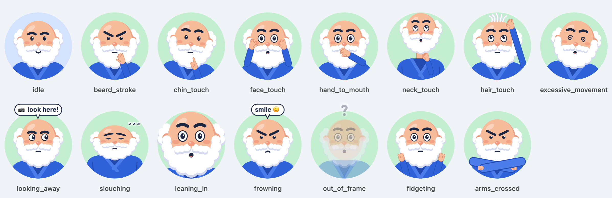

<p align="center"></p>

<h1 align="center">Miyagi</h1>

<p align="center"><b>Your private, real-time meeting coach.</b></p>

A local, AI-powered web app that watches your webcam **during video meetings** and gently
alerts you, in real time, when you slip into unconscious habits.

**Current focus: beard stroking and chin touching.** These two, plus **touching face**,
**touching neck**, **too close to camera** and **slouching**, are on by default. Eight more habits
(hair, hand at mouth, rocking, looking away, frowning...) are built in and switched off; turn them
on under *Habits → More habits* when you want them.

When a habit is detected you get a cue of your choice: a **red rectangle** around the spot,
an **emoji mask** over your face, a **glowing border**, a cartoon **avatar ("Mr. Miyagi") that acts
out what you're doing**, a **toast** with a tip, or a soft **sound**. Repeat a habit and the
cues get louder. At the end you get a short **coaching report**.

The UI follows **Material Design 3** (Google colors, Google Sans Flex, Material Symbols), in light and dark.


<details><summary>Dark theme and the Habits settings</summary>


</details>



> **Privacy:** everything runs on your machine. Video is analysed locally and never stored or
> uploaded, the report is written locally, and the app calls no cloud APIs. The only download
> is the vision models on first run. Fonts and icons are bundled, so the UI makes no third-party requests.

## Quick start

Requires [uv](https://docs.astral.sh/uv/) and a webcam.

```bash
git clone https://github.com/SherifEldeeb/Miyagi && cd Miyagi
uv sync
uv run miyagi          # first run downloads ~17 MB of vision models, then opens http://localhost:8000
```

1. Click **Start camera** and sit naturally for 3 seconds while it calibrates.
2. Click **Pop out** for a small always-on-top coach window to keep next to Zoom, Meet or Teams.
3. When you're done, click **End & report**.

### Port and host

```bash
uv run miyagi --port 8080                 # or: MIYAGI_PORT=8080 uv run miyagi
uv run miyagi --host 0.0.0.0 --port 8080  # listen on all interfaces (other machines need HTTPS for the camera)
```

> Habit settings are saved per browser **origin**, which includes the port. If you change the port,
> set up your habits again (or keep using the same port).

### Coach view ("production" mode): camera and cues only

For meetings you probably don't want toolbars and settings on screen. The **coach view** shows
only the camera and the cues (box, mask, border, Mr. Miyagi, tips). It starts the camera automatically
and uses the habit settings you saved in the full UI.

```bash
uv run miyagi --coach --port 8080         # opens http://localhost:8080/coach
```

You can also open `http://localhost:<port>/coach` any time, or click **Coach view** in the full UI.
There are no on-screen controls, only keyboard shortcuts:

| Key | Action |
|---|---|
| `P` | pop out (floating, always-on-top window) |
| `C` | calibrate (sit naturally for 3 s) |
| `Space` | pause / resume |
| `F` or double-click | full screen |
| `M` | mirror on/off |
| `H` or `?` | show these shortcuts |

Tune habits in the full UI (`http://localhost:<port>/`), then use the coach view during calls.

CLI options: `--port`, `--host`, `--coach`, `--no-browser` (`uv run miyagi --help`).

### Chromebook

Run the server in ChromeOS's Linux environment and use ChromeOS's own Chrome for the camera.
The browser captures the webcam and streams frames to the server, so Linux never needs camera
access. MediaPipe has wheels for both Intel (x86_64) and ARM (aarch64) Chromebooks.

1. Turn on Linux: *Settings → About ChromeOS → Developers → Linux development environment*
   (give it at least 10 GB), then open the **Terminal** app.
2. Install the system libraries, then uv (reopen the Terminal afterwards so `uv` is on your PATH):

   ```bash
   sudo apt update && sudo apt install -y libegl1 libgles2 git curl
   curl -LsSf https://astral.sh/uv/install.sh | sh
   ```

3. Get the code and run it. Use `--no-browser`, because the container can't open ChromeOS's Chrome:

   ```bash
   git clone https://github.com/SherifEldeeb/Miyagi && cd Miyagi && uv sync
   uv run miyagi --no-browser
   ```

4. Open `http://localhost:8000` in Chrome on the ChromeOS side. ChromeOS forwards Linux ports
   to `localhost`, which Chrome treats as secure, so the camera works.

If it doesn't load, check *Settings → Developers → Linux → Port forwarding* and add port 8000.
The fallback address `http://penguin.linux.test:8000` isn't `localhost`, so Chrome may block the camera there.
On a low-end Chromebook, close other tabs and use the coach view (`--coach`, then open `/coach`),
which draws less. Meet in a Chrome tab and Miyagi can share the camera, and **Pop out** keeps the coach
window over the call.

### Remote Linux host over SSH (camera stays local)

If you can't run it locally (for example, a managed Chromebook with Linux turned off), run the server
on a Linux host you control and tunnel the port. The browser still captures the camera on your machine
and sends frames through the tunnel, so there are no code changes and the page is still `localhost`, which lets Chrome use the camera.

On the remote host (copy and paste):

```bash
sudo apt update && sudo apt install -y libegl1 libgles2 git curl tmux
curl -LsSf https://astral.sh/uv/install.sh | sh
export PATH="$HOME/.local/bin:$PATH"
git clone https://github.com/SherifEldeeb/Miyagi && cd Miyagi && uv sync
tmux new -d -s miyagi 'uv run miyagi --no-browser --port 8000'
```

It listens on `127.0.0.1` by default, so it's reachable only through the tunnel; don't pass `--host 0.0.0.0`.
`tmux attach -t miyagi` shows the server; `tmux kill-session -t miyagi` stops it.

On your machine, open the tunnel, then browse to `http://localhost:8000`:

```bash
ssh -N -L 8000:localhost:8000 you@remote-host
```

On a Chromebook without Linux, the **Secure Shell** extension can make the same tunnel: put
`-L 8000:localhost:8000` in *SSH Arguments*.

> **Privacy:** in this setup, frames leave your machine. They are encrypted by SSH and never stored,
> but they are processed on the remote host, so use only a host you control.

- **Bandwidth:** frames are 640 px wide JPEGs at 12 fps by default, roughly 3–4 Mbit/s upload.
  Lower *FPS* in the settings on a weak connection.
- **Latency:** one frame is in flight at a time, so the frame rate is at most about 1 / round-trip time
  (about 8–10 fps at 100 ms), and cues arrive about one round trip late.
- Habit settings are saved in your local browser per origin, so keep using the same local port.

## Habits

| Habit | Default | What triggers it |
|---|---|---|
| 🧔 **Stroking beard** | **on (focus)** | hand *moving* on the beard/chin |
| 🤔 **Touching chin** | **on (focus)** | hand resting on the chin/jaw/beard, or propping your head |
| 🙈 Touching face | **on** | fingertips on eyes, nose or cheeks |
| 🤐 Hand at mouth | off | fingertips on the lips |
| 🦒 Touching neck | **on** | fingertips below the beard |
| 💇 Playing with hair | off | fingertips above the forehead |
| 🌀 Moving / rocking a lot | off | sustained head movement |
| 👀 Looking away from camera | off | head turned or eyes off the camera vs. your baseline |
| 🐢 Slouching | **on** | shoulders/neck lower than your baseline |
| 🔍 Too close to camera | **on** | face much bigger than your baseline |
| 😠 Frowning | off | furrowed brows |
| 🫥 Out of frame | off | no face for a few seconds |
| 🫨 Restless hands | off | lots of hand motion |
| 🙅 Arms crossed | off | arms crossed over the body |

By default every habit uses the **red border** cue, plus its own mix of box, emoji mask, Mr. Miyagi and tip.
Each habit has its own **sensitivity**, **hold time** (how long before it alerts), **cooldown**,
**detection mode** and **cues**, set in the *Habits* tab and remembered by your browser.
The *Debug overlay* helps with tuning. It draws what the models see: the detection zones, the face
mesh (outline, eyes, lips, irises, all 478 points and the landmarks the detectors use), the hand and
body skeletons, and a panel with head pose, your strongest expressions and each habit's live signal
against its on/off thresholds. *Face mesh* adds the full mesh wireframe.

## Teach it your habits (personal model)

People stroke beards differently. In the **Teach** tab:

1. Record **Neutral** (sit and talk normally) for about 10 s.
2. Record **Stroking beard** and **Touching chin** for about 10 s each, varying the gesture a little.
3. Click **Train personal model** (it takes about a second, on your CPU).
4. In *Habits*, set the habit's *Detect with* to `either` (rules OR your model) or `learned`.

Only landmark coordinates are saved (never images), in `~/.local/share/miyagi/`.
**Clear all samples** deletes them.

## Coaching report

**End & report** shows a short summary of the session, written on your machine from the
session's counts: how often each habit came up (and per 10 minutes), a tip for each of the top
three, and which habits you avoided. Nothing is sent anywhere.

## Configuration

| Variable | Purpose | Default |
|---|---|---|
| `MIYAGI_PORT` | port (same as `--port`) | `8000` |
| `MIYAGI_HOST` | bind address (same as `--host`) | `127.0.0.1` |
| `MIYAGI_COACH_VIEW` | `1` opens the coach view on start (same as `--coach`) | off |
| `MIYAGI_MODEL_DIR` | MediaPipe model cache | `$XDG_CACHE_HOME` or `~/.cache`, then `/miyagi/models` |
| `MIYAGI_DATA_DIR` | Teach-mode samples and personal model | `$XDG_DATA_HOME` or `~/.local/share`, then `/miyagi` |

## Troubleshooting

- **`libEGL.so.1: cannot open shared object file`** (Linux): `sudo apt install libegl1 libgles2`.
- **Camera busy / black** (Windows): some drivers let only one app use the camera at a time.
  Route it through OBS Virtual Camera, or start Miyagi before your meeting app.
- **Camera blocked:** browsers only allow the camera on `localhost` or HTTPS; use the URL the app prints.
- **Too many or too few alerts:** adjust *Sensitivity* and *Hold* in *Habits*, click **Calibrate**
  while sitting normally, or use Teach mode.
- **Pop out does nothing:** Picture-in-Picture needs Chrome, Edge or Safari (Firefox support is limited).

## Documentation

| Doc | For |
|---|---|
| [INTENT.md](INTENT.md) | why this exists, goals and non-goals, decision log |
| [DESIGN.md](DESIGN.md) | architecture, detectors, engine, protocol, UI theme, how to extend |
| [AGENTS.md](AGENTS.md) | contributor and AI-agent guide: commands, rules, keeping docs updated |

## Development

```bash
uv sync
uv run pytest            # includes tests/test_docs.py, which checks the docs against the code
uv run ruff check .
```

Read [AGENTS.md](AGENTS.md) before contributing. Docs are updated in the same change as the code.
