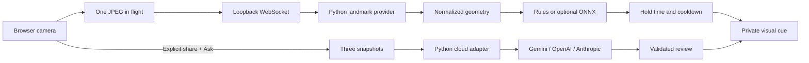

# Architecture

## Two independent paths

`getUserMedia` captures video without audio. The browser resizes JPEGs to fit 640×480, sends one at a time, and waits for the response before scheduling the next capture after 125 ms. This applies backpressure rather than queuing stale frames. Effective sampling frequency is below 8 FPS and depends on inference time; no latency guarantee is claimed.

Each WebSocket owns its landmark models, engine state, and one inference worker. The app permits one camera session at a time. A disconnect closes model resources. Missing tracking or a gap over 750 ms breaks the contact hold; cues resume only after a new sustained observation. Recalibration resets motion and hold state. Pausing disables all cue conditions server-side while keeping tracking active.

## Vendor independence

Three boundaries avoid tying the application to a single hosted AI vendor:

1. `LandmarkProvider` returns plain `Landmarks`. The current implementation runs downloaded MediaPipe models locally. Another landmark framework can implement the same face-index contract or translate its output to this canonical representation.
2. `CoachEngine` owns geometry, timing, enabled conditions, and cooldowns. Its tests are independent of the vision model and cloud SDKs.
3. `CloudReviewer` consumes JPEGs and a `ReviewRequest`, returning a validated `Review`. `SDKReviewer` contains provider-specific SDK calls. New hosted services can implement this protocol without rewriting camera UI or local rules.

The optional `OnnxClassifier` consumes a versioned, numeric feature window. It uses standard ONNX Runtime CPU inference; training is separate from serving. Model metadata locks feature order, window size, class mapping, and the probability threshold.

Using MediaPipe locally does create an implementation dependency on its landmarks, but not on a Google account, API key, hosted inference endpoint, or paid plan. The distributed SDK may emit usage/performance telemetry to Google, as disclosed in the UI and [privacy notice](https://developers.google.com/edge/mediapipe/solutions/privacy); local image inference is not a guarantee of zero network traffic. Replacing that dependency requires a compatible landmark mapping, not a cloud-provider migration.

## Authentication matrix

| Selection | SDK construction | Server-side configuration |
| --- | --- | --- |
| Gemini / API key | `genai.Client(vertexai=False, api_key=...)` | `GEMINI_API_KEY` or `GOOGLE_API_KEY` |
| Gemini / Vertex ADC | `genai.Client(vertexai=True, credentials=..., project=..., location=...)` | ADC, project, region |
| Gemini / Vertex API key | `genai.Client(vertexai=True, api_key=...)` | `VERTEX_API_KEY` for express mode |
| OpenAI / API key | `OpenAI(api_key=...)` | `OPENAI_API_KEY` |
| Anthropic / API key | `Anthropic(api_key=...)` | `ANTHROPIC_API_KEY` |
| Anthropic / Vertex ADC | `AnthropicVertex(project_id=..., region=...)` | ADC, project, region |

For Gemini ADC, credentials are explicitly resolved through `google.auth.default` so an unrelated API-key environment variable cannot silently select the wrong auth route. Unsupported combinations are rejected by the request schema and omitted from the UI. Vertex ADC does not mean sending a Google token to OpenAI. Anthropic API keys are for the direct Claude endpoint, not the Google-managed Vertex endpoint.

## Defensive boundaries

- Loopback binding and trusted-host checks; same-origin validation on mutation and WebSocket requests.
- HTTP body, frame byte, image-dimension, model-name, and settings limits.
- JPEG decoding/re-encoding before cloud transmission, discarding image metadata.
- One cloud request at a time; at least ten seconds between reviews; SDK timeouts and no automatic SDK retries for billable calls.
- Provider errors are reduced to exception type, without echoing SDK request bodies or credentials.
- Model output is parsed as bounded JSON with an allowlist of condition names; rendered with `textContent`.
- An explicit consent flag is required server-side. Switching provider/auth resets the browser checkbox. The app never puts credentials into client JavaScript.
- No third-party scripts, fonts, or icon requests at runtime. Assets are self-hosted; CSP limits the page to its own origin.

These are local-app boundaries, not a substitute for production identity, authorization, quotas per user, tenant isolation, or a full deployment review.

## Adding another habit

Add a stable identifier to the condition schema, an observation rule and neutral cue to the engine, a disabled-by-default UI control, and timing/occlusion tests. Include the condition in the cloud prompt and structured schema. Changing the learned feature layout requires a new metadata version and retraining; never reinterpret an older ONNX file silently.

## Primary references

- [MediaPipe Face Landmarker](https://ai.google.dev/edge/mediapipe/solutions/vision/face_landmarker/python)
- [MediaPipe Hand Landmarker](https://ai.google.dev/edge/mediapipe/solutions/vision/hand_landmarker/python)
- [MediaPipe Pose Landmarker](https://ai.google.dev/edge/mediapipe/solutions/vision/pose_landmarker/python)
- [Google Gen AI Python SDK](https://googleapis.github.io/python-genai/)
- [OpenAI Python SDK and image input](https://developers.openai.com/api/reference/python)
- [Claude vision input](https://platform.claude.com/docs/en/build-with-claude/vision)
- [Claude on Google-managed Vertex](https://platform.claude.com/docs/en/build-with-claude/claude-models-on-google-cloud/google-managed)
